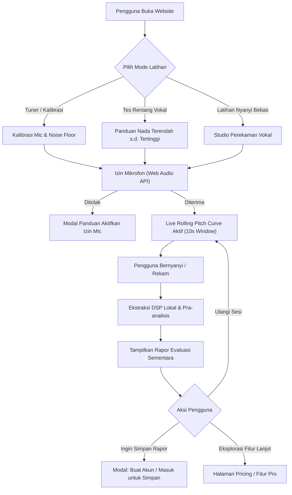
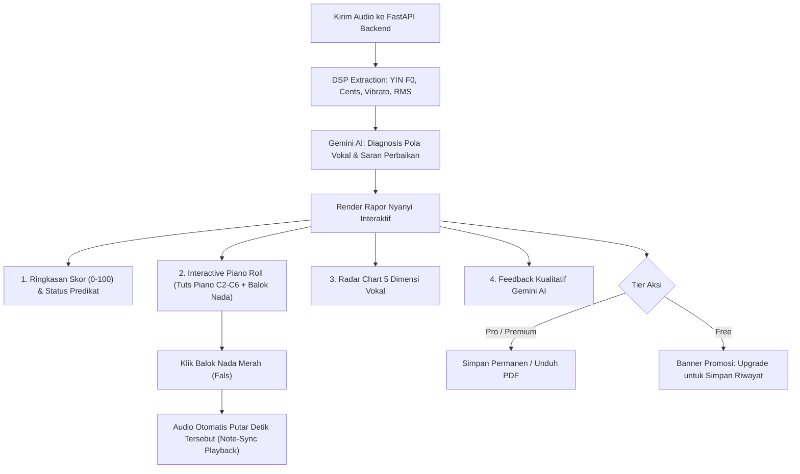

# VOCALSENSE AI — USER FLOW & INFORMATION ARCHITECTURE
**Dokumen Desain Sistem UI/UX (Bottom-Up Foundation)**  
*Lokasi: `D:\Kuliah\IPPL\ui-ux\USER_FLOW_LOGIC.md`*  
*Versi: 1.0 — Tahap 1: Fondasi Logika & Arsitektur Alur*

---

## 1. PENDEKATAN "BOTTOM-UP" DESAIN UI/UX
Dalam standar industri modern (dan *anti-slop* framework), desain tidak dimulai dari menggambar tombol atau memilih warna. Desain dibangun dari bawah ke atas (*Bottom-Up*):

```
┌────────────────────────────────────────────────────────┐
│  5. HIGH-FIDELITY & FIGMA CANVAS (Komponen, Prototype) │ ▲ Finishing
├────────────────────────────────────────────────────────┤ │
│  4. DESIGN SYSTEM & VIBE (Warna, Tipografi, Spacing)   │ │
├────────────────────────────────────────────────────────┤ │
│  3. WIREFRAME & BENTO LAYOUT (Struktur Komposisi Layar)│ │
├────────────────────────────────────────────────────────┤ │
│  2. INFORMATION ARCHITECTURE & USER FLOW (Logika Alur) │ │
├────────────────────────────────────────────────────────┤ │
│  1. CORE REQUIREMENTS & DSP METRICS (Kebutuhan Sistem) │ │ Fondasi
└────────────────────────────────────────────────────────┘
```

Saat ini kita berada di **Tahap 1 & 2: Memetakan seluruh logika alur (User Flow) dan hierarki informasi (IA)** agar antarmuka yang dirancang nantinya tidak bolong secara fungsional.

---

## 2. PENGGUNA & HAK AKSES (ACTOR TAXONOMY)

| Aktor | Status Autentikasi | Kapabilitas & Batasan UI |
| :--- | :--- | :--- |
| **Guest (Tamu)** | Belum login | Akses instan di web: Tuner, Vocal Range Test, Rekam vokal max 10s, Live Pitch Visualizer, Rapor sementara (hilang jika reload). |
| **Free User** | Login (Gratis) | Sama seperti Guest, tetapi profil vokal tersimpan, rekam vokal hingga 10s, riwayat latihan dasar. |
| **Pro User** | Login (Berlangganan) | Rekam vokal hingga 60s, Simpan Rapor Nyanyi permanen, Pemutar audio sinkron nada fals (*Note-Sync Playback*), Ekspor Rapor & Sertifikat PDF. |
| **Premium User** | Login (Berlangganan) | Rekam vokal hingga 180s, Semua fitur Pro, Dasbor tren mingguan/bulanan, *AI Personalized Vocal Coach & Practice Planner* (Gemini), Latihan tangga nada interaktif, Streak & Gamifikasi. |
| **Administrator** | Login (Admin) | Dasbor manajemen pengguna, pemantauan analitik finansial & utilisasi AI. |

---

## 3. LOGIKA ALUR PENGGUNA UTAMA (USER FLOWS)

### Flow 1: Zero-Friction Instant Test (Akses Tamu / In-Browser First)
*Filosofi UX: Mengikuti benchmark Voice Gender Analyzer — pengguna tidak boleh dipaksa registrasi di awal.*



---

### Flow 2: Studio Rekaman & Live Pitch Visualizer
*Alur di dalam studio saat pengguna sedang bernyanyi.*

1. **Persiapan (Pre-roll):**
   - Indikator volume input mic (dB meter) bergerak untuk memastikan sinyal masuk.
   - Pilihan metronom / backing track / tangga nada panduan (*optional toggle*).
   - Tombol utama: **"Mulai Rekam"** (Countdown 3-2-1).
2. **Saat Bernyanyi (Recording Active):**
   - Layar menampilkan **Live Rolling Pitch Curve** (rentang 55 Hz – 880 Hz).
   - Nada aktual terdeteksi (misal: `C4`, `A3`) muncul dengan status warna:
     - 🟢 **Hijau:** Tepat nada (Deviasi < ±15 cents).
     - 🟡 **Kuning:** Sedikit deviasi (±15 hingga ±30 cents).
     - 🔴 **Merah:** Fals / Flat / Sharp (Deviasi > ±30 cents).
   - Timer menghitung sisa durasi (sesuai batasan tier: 10s / 60s / 180s).
3. **Penyelesaian Sesi:**
   - Tombol **"Selesai & Analisis"** ditekan (atau durasi habis otomatis).
   - Gelombang suara (*Waveform*) terbentuk.
   - Pengguna dapat memotong/memangkas (*Trim Audio*) sebelum dikirim ke engine AI.

---

### Flow 3: Diagnostic Report Card & Piano Roll Interaktif
*Alur pemeriksaan hasil setelah rekaman dianalisis oleh DSP & Gemini AI.*



---

### Flow 4: Personalized AI Vocal Coach & Practice Planner (Premium Flow)
*Alur bimbingan latihan harian adaptif.*

1. **Dashboard Progres Vokal:**
   - Menampilkan grafik tren mingguan (*Pitch Accuracy Rate %*, *Vocal Range Expansion C2 $\rightarrow$ A4*).
   - Kalender *Daily Singing Streak* dan *Lencana Prestasi*.
2. **AI Practice Planner (Gemini Engine):**
   - AI mendeteksi kelemahan akumulatif (contoh: *"Pengguna sering flat saat transisi Chest ke Head Voice"*).
   - AI menghasilkan **Silabus Latihan 7-30 Hari**.
3. **Sesi Latihan Interaktif (Solfeggio Drills):**
   - Pemutar audio membunyikan nada panduan piano (Do-Re-Mi / Arpeggio).
   - Pengguna menirukan nada.
   - Sistem menilai ketepatan secara *real-time* dan mencatat progres harian.

---

### Flow 5: Upgrade & Payment Flow (Midtrans Integration)
*Alur transaksi monetisasi.*

1. Pengguna memilih paket di halaman **Pricing** (Bulanan / Tahunan untuk Pro atau Premium).
2. Sistem membuat order token via **Midtrans Snap API**.
3. Pop-up Snap muncul di layar (Pilihan: QRIS, GoPay, Virtual Account BCA/Mandiri/BNI).
4. Pengguna menyelesaikan pembayaran.
5. Midtrans mengirimkan notifikasi *Webhook* ke Backend VocalSense AI.
6. Status tier akun pengguna seketika berubah menjadi Pro / Premium tanpa perlu refresh manual.
7. Notifikasi sukses & invoice otomatis terbit di menu akun pengguna.

---

## 4. HIERARKI STRUKTUR LAYAR (SITEMAP & SCREEN ARCHITECTURE)

```
VocalSense AI
├── 1. Public / Guest Surfaces
│   ├── Landing Page (Hero, Value Proposition, Interactive Demo Preview, Pricing Table)
│   ├── Vocal Studio (In-Browser Live Pitch Visualizer, Tuner, Range Finder)
│   ├── Quick Report Preview (Temporary Rapor Nyanyi)
│   ├── Auth Modal / Pages (Login, Register, Forgot Password, Google OAuth)
│   └── Pricing & Tier Comparison Page
│
├── 2. User App Surfaces (Logged In: Free, Pro, Premium)
│   ├── Main Studio (Studio Rekaman Penuh, Upload Audio File, Waveform Trimmer)
│   ├── Detailed Singing Report (Piano Roll Canvas, Note-Sync Audio Player, Radar Chart, PDF Export)
│   ├── Vocal Range Profile (Peta register suara: Chest, Mix, Head, nada terendah/tertinggi)
│   ├── Session Comparison (Membandingkan 2 rekaman audio side-by-side)
│   ├── Practice Center (Premium: AI Curriculum, Solfeggio Scale Trainer, Metronom)
│   ├── Progress & Analytics Dashboard (Premium: Grafik tren akurasi, Streak, Gamifikasi)
│   └── Account & Billing (Manajemen Profil, Riwayat Langganan, Invoice Midtrans)
│
└── 3. Admin Surfaces
    ├── Overview Metrics (Total User, Active Sessions, Revenue, AI API Usage)
    ├── User & Tier Management (Pencarian user, perubahan tier manual)
    └── Financial & Analytics Log
```

---

## 5. SKENARIO ERROR & STATE HANDLING (ANTI-SLOP RESILIENCE)

| Skenario Error | Respon Antarmuka (UI/UX Pattern) |
| :--- | :--- |
| **Izin Mic Ditolak** | Banner instruksi visual yang ramah dan jelas menunjukkan cara membuka kunci izin microphone di browser bar. |
| **Audio Terlalu Pelan / Terlalu Bising** | Indikator kalibrasi (*Noise Floor Alert*) memberi tahu pengguna untuk mendekatkan mic atau berpindah ke ruangan yang lebih tenang. |
| **Tidak Ada Suara Terdeteksi** | Jika setelah 5 detik bernyanyi tidak ada $F_0$ yang valid, visualizer menampilkan panduan: *"Coba bersuara lebih jelas atau periksa input mikrofon."* |
| **Pemrosesan AI Sedang Berjalan** | *Skeleton loader* dengan visualizer gelombang berdenyut elegan (bukan spinner bulat murah), menampilkan progres tahapan: *"Mengekstrak frekuensi YIN $\rightarrow$ Menghitung deviasi cents $\rightarrow$ Konsultasi AI Coach..."* |
| **Koneksi Terputus Saat Rekam** | Data rekaman audio lokal di-*buffer* di peramban pengguna (*IndexedDB / Cache*) sehingga audio tidak hilang sia-sia. |
